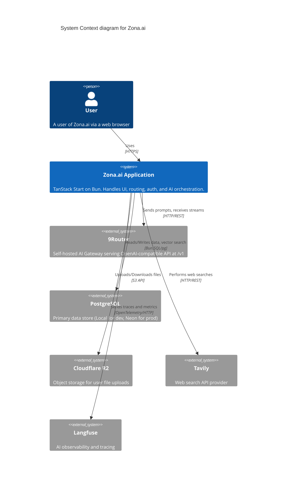

# Zona.ai System Architecture

This document describes the system architecture for Zona.ai, a full-stack TypeScript AI chat workspace application featuring multi-model comparisons.

## 1. System Context

Zona.ai is a full-stack application built on TanStack Start with the Bun runtime. It acts as the orchestration layer between the user interface and various backend services, most notably the 9Router AI gateway.



## 2. High-Level Architecture

Zona.ai is built as a monolithic full-stack application, ensuring simplicity in development and deployment. We explicitly avoid microservices for this architecture.

```mermaid
flowchart LR
    Browser[Browser / Client]
    
    subgraph ZonaAI[Zona.ai Monolith (TanStack Start + Bun)]
        Frontend[React Frontend\nTanStack Query\nTanStack Router\nTanStack Virtual]
        Backend[Server Functions & Routes\nDrizzle ORM\nAI SDK 7\nBetter Auth]
        
        Frontend <--> |createServerFn (RPC) / HTTP| Backend
    end
    
    subgraph ExternalServices[External Services]
        NineRouter[9Router]
        PostgreSQL[(PostgreSQL)]
        R2[(Cloudflare R2)]
        Tavily[Tavily]
        Langfuse[Langfuse]
    end
    
    Browser <--> |HTTPS| Frontend
    Backend <--> NineRouter
    Backend <--> PostgreSQL
    Backend <--> R2
    Backend <--> Tavily
    Backend -.-> |Traces| Langfuse
```

## 3. TanStack Start + Bun Relationship

- **Bun**: The core JavaScript/TypeScript runtime executing the server, building the application, and running scripts.
- **TanStack Start**: The full-stack framework running on top of Bun, managing both server and client rendering.
- **TanStack Router**: Handles file-based routing for the application.
- **TanStack Query**: Manages server state on the client side, caching, and data fetching.
- **`createServerFn`**: Used for internal RPC calls. This provides type-safe, same-origin server functions (e.g., loaders, mutations).
- **Server Routes**: Used for external endpoints, such as auth callbacks, webhooks, or raw file downloads.

## 4. Frontend/Server Boundaries

There is a clear separation of concerns to ensure security and clean architecture:

- **Client-only**: React components, TanStack Query hooks, UI state management, and consumption of text streams.
- **Server-only**: Database access, direct 9Router API calls, R2 operations, Tavily integration, authentication verification, and secret/environment variable management.
- **Shared**: TypeScript types, validation schemas (Zod), and application constants.

> [!IMPORTANT]
> The Frontend NEVER calls 9Router directly. The flow is always: Browser → Zona.ai Server → AI SDK → 9Router.

## 5. AI Architecture

Zona.ai leverages the Vercel AI SDK 7 to interface with 9Router, which abstracts multiple LLM providers.

```mermaid
flowchart TD
    Client[Browser UI]
    ServerFn[TanStack Start Server Function]
    AISDK[AI SDK 7 (streamText / generateText)]
    Adapter[@ai-sdk/openai-compatible]
    NineRouter[9Router (/v1/chat/completions)]
    LLMs[GPT / Claude / Gemini / etc.]
    
    Client -->|Prompt + Context| ServerFn
    ServerFn --> AISDK
    AISDK --> Adapter
    Adapter -->|HTTP POST| NineRouter
    NineRouter -->|Routing/Fallback| LLMs
    LLMs -.->|Stream| NineRouter
    NineRouter -.->|Stream| Adapter
    Adapter -.->|Stream| AISDK
    AISDK -.->|DataStreamResponse| Client
```

- **9Router Responsibility**: Gateway, API key management for providers, routing, tier fallback, and load balancing.
- **Zona.ai Responsibility**: Model selection, orchestration of compare mode, managing parallel generations, conversation state, generation state, retries, cancellation, persistence, RAG context injection, web-search context injection, and tracking usage/latency.

## 6. Compare Mode Architecture

Compare Mode allows users to evaluate multiple models side-by-side with parallel streaming.

```
1. User sends prompt with selected models [A, B, C]
2. Zona.ai Server creates a ComparisonRun record in DB
3. For each model, creates an independent GenerationRun
4. Executes parallel streamText() calls via AI SDK to 9Router
5. Each stream independently sends events/chunks to the client
6. Client demultiplexes incoming streams by generationId/modelId
7. Individual model failures do not block or crash other parallel generations
```

## 7. Database Architecture

- **Primary Store**: PostgreSQL.
- **ORM**: Drizzle ORM for type-safe schema management, migrations, and queries.
- **Vector Search**: `pgvector` extension for similarity search, primarily for RAG workflows.
- **Environments**: Local PostgreSQL for development, Neon (managed Serverless Postgres) for production.
- **Driver**: Bun.SQL (if fully compatible with Drizzle) or standard PostgreSQL driver.

## 8. Authentication Architecture

- **Provider**: Better Auth using the Drizzle adapter (`provider: "pg"`).
- **Authentication Method**: **Google OAuth Only** (no username/password or credential storage). Eliminates password-related security vulnerabilities and delivers zero-friction 1-click login.
- **Provider Credentials**: `GOOGLE_CLIENT_ID` and `GOOGLE_CLIENT_SECRET`.
- **Integration**: `tanstackStartCookies()` plugin for seamless cookie handling in TanStack Start.
- **Routing**: Auth handler mounted at a catch-all server route: `/api/auth/$`.
- **Methodology**: Session-based authentication backed by HTTP-only secure cookies and the `sessions` table.
- **Security**: Server-side auth checks must be present in every protected server function. Route protection via TanStack Router's `beforeLoad` is used for UX purposes only, not as a security boundary.

## 9. Object Storage Architecture

- **Provider**: Cloudflare R2 for S3-compatible file storage without egress fees.
- **Usage**: Storing user attachments (Images, PDFs, DOCX, TXT, CSV).
- **Data Model**: Metadata (name, size, type, upload date, parsed status) stored in PostgreSQL, binary data in R2.
- **Access**: File access and uploads go through server functions/routes only (no direct browser-to-R2 uploads).

## 10. RAG Architecture

The pipeline for processing user documents into context for the AI:

```
Upload → Validation → R2 Storage → Text Extraction → Chunking → Embedding → pgvector → Retrieval → AI Context
```

- **Storage & Search**: Uses PostgreSQL with the `pgvector` extension using HNSW indexes for fast similarity search.
- **Embedding Model**: TBD (configurable; either routed via 9Router or a dedicated embedding endpoint).

## 11. Web Search Architecture

- **Primary Provider**: Tavily API for intelligent web context retrieval.
- **Abstraction**: Placed behind a service abstraction layer to allow switching if needed.
- **Compare Mode MVP**: Uses "Fair Compare" – web evidence is retrieved once by the server and sent identically as context to all selected models.
- **Future Expansion**: Exa is reserved for future, more advanced research workflows.

## 12. Observability Architecture

- **AI Observability**: Langfuse handles traces, generation tracking, and cost estimations.
- **Integration**: `@langfuse/vercel-ai-sdk` + `@langfuse/otel` + OpenTelemetry.
- **Tracing**: Auto-traces `streamText`, `generateText`, tool calls, and embedding operations.
- **General Observability**: OpenTelemetry can be expanded later if the application scales significantly.

## 13. Server-Only Modules

The following components and modules must **NEVER** be imported on the client side:
- Database clients, ORM configurations, and queries
- 9Router API configurations or credentials
- Cloudflare R2 SDK clients
- Tavily or Exa SDK clients
- Langfuse configuration and telemetry initialization
- Auth server instances
- Any file containing environment secrets (`process.env.SECRET_*`)

## 14. Deployment Architecture

- **Development**: Local Bun runtime + Local PostgreSQL instance + Local 9Router.
- **Production**: TBD deployment target (configurable) + Neon PostgreSQL + Cloudflare R2.
- **Artifact**: A single deployable unit (monolith), built via TanStack Start on Bun.

## 15. Architecture Decision Records (ADRs)

- **ADR-001**: **TanStack Start over Next.js**. Chosen for its flexibility, Bun-native performance, and deep integration with the TanStack ecosystem.
- **ADR-002**: **9Router as AI gateway**. Chosen as a self-hosted, provider-agnostic, OpenAI-compatible proxy to unify LLM access.
- **ADR-003**: **PostgreSQL + pgvector over Qdrant**. Chosen for a simpler stack for MVP and fewer moving parts, keeping transactional and vector data in one place.
- **ADR-004**: **Better Auth over Clerk/Auth0**. Chosen for self-hosting capability, native Drizzle integration, and native TanStack Start support.
- **ADR-005**: **Cloudflare R2 over S3**. Chosen for its S3 compatibility and lack of egress fees, which is critical for potentially heavy document usage.
- **ADR-006**: **Monolith over microservices**. Chosen for deployment simplicity. It is sufficient for MVP scale.
- **ADR-007**: **Drizzle over Prisma**. Chosen for better TypeScript inference, lightweight runtime footprint, and better Bun compatibility.

## 16. Scalability Path

- **Current State**: Single-instance monolith.
- **Future Considerations**: 
  - Horizontal scaling of the application instances.
  - Database connection pooling (e.g., PgBouncer or Neon's built-in pooling).
  - CDN caching for static assets.
  - Dedicated background job processing for heavy tasks (e.g., large document chunking and embedding).

## 17. Technology Restrictions

> [!WARNING]  
> The following technologies must **NOT** be introduced without an explicit architecture change approval:
> - Next.js, Express, Elysia
> - Supabase, Firebase
> - Prisma
> - MongoDB, Redis, Kafka
> - Qdrant (for MVP)
> - Microservices infrastructure
