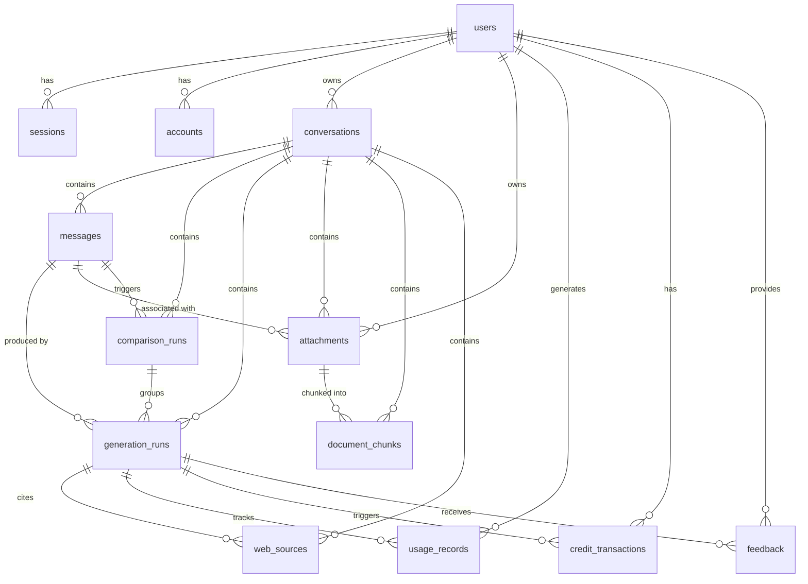

# Zona.ai Database Schema Specification

This document details the database schema, relationships, and data management strategies for Zona.ai, an AI chat workspace featuring multi-model comparison. 

## Technology Stack

- **Database Engine**: PostgreSQL (Local for Dev, Managed preferred Neon for Prod)
- **ORM**: Drizzle ORM
- **Driver**: Bun.SQL (if compatible) / Postgres.js
- **Vector Search**: `pgvector` extension
- **Authentication Schema**: Managed by Better Auth (`drizzleAdapter`)

## Entity-Relationship Diagram

## Table Definitions

### 1. Authentication Tables (Better Auth Managed)

These tables are managed by Better Auth's schema generation. **Do not manually alter their core structure**, though you may add application-specific columns if needed (and supported by Better Auth plugins).

#### `users`
- `id` (text, PK) — Better Auth uses text IDs
- `name` (text)
- `email` (text, unique, not null)
- `emailVerified` (boolean)
- `image` (text, nullable)
- `credits` (integer, default 100, not null) — User's active credit balance
- `createdAt` (timestamp)
- `updatedAt` (timestamp)

#### `sessions`
- `id` (text, PK)
- `userId` (text, FK → `users.id`, ON DELETE CASCADE)
- `token` (text, unique)
- `expiresAt` (timestamp)
- `ipAddress` (text, nullable)
- `userAgent` (text, nullable)
- `createdAt` (timestamp)
- `updatedAt` (timestamp)

#### `accounts`
- `id` (text, PK)
- `userId` (text, FK → `users.id`, ON DELETE CASCADE)
- `accountId` (text)
- `providerId` (text)
- `accessToken` (text, nullable)
- `refreshToken` (text, nullable)
- `accessTokenExpiresAt` (timestamp, nullable)
- `refreshTokenExpiresAt` (timestamp, nullable)
- `scope` (text, nullable)
- `password` (text, nullable)
- `createdAt` (timestamp)
- `updatedAt` (timestamp)

### 2. Core Chat Tables

#### `conversations`
- `id` (uuid, PK, default `gen_random_uuid()`)
- `userId` (text, FK → `users.id`, ON DELETE CASCADE)
- `title` (text, nullable) — Auto-generated or user-set
- `mode` (text, not null, default `'normal'`) — `'normal'` | `'compare'`
- `isArchived` (boolean, default `false`)
- `createdAt` (timestamp, default `now()`)
- `updatedAt` (timestamp, default `now()`)
- **Indexes**: `userId`, `createdAt` DESC
- **Notes**: Authorization logic must ensure users can only access their own conversations.

#### `messages`
- `id` (uuid, PK)
- `conversationId` (uuid, FK → `conversations.id`, ON DELETE CASCADE)
- `role` (text, not null) — `'user'` | `'assistant'` | `'system'`
- `content` (text) — Message text content
- `createdAt` (timestamp, default `now()`)
- **Indexes**: `conversationId` + `createdAt`
- **Notes**: In Compare Mode, a single user message may have multiple assistant responses linked via `generation_runs`.

### 3. Generation & Comparison Tables

#### `comparison_runs`
Groups `generation_runs` for a Compare Mode request.
- `id` (uuid, PK)
- `conversationId` (uuid, FK → `conversations.id`, ON DELETE CASCADE)
- `userMessageId` (uuid, FK → `messages.id`, ON DELETE CASCADE) — The user message that triggered the comparison
- `status` (text, not null) — `'running'` | `'completed'` | `'partial_failure'` | `'failed'`
- `modelIds` (text[], not null) — Array of model IDs selected for comparison
- `createdAt` (timestamp, default `now()`)
- `completedAt` (timestamp, nullable)
- **Indexes**: `conversationId`

#### `generation_runs`
Represents an individual AI generation (one per model per message).
- `id` (uuid, PK)
- `messageId` (uuid, FK → `messages.id`, ON DELETE CASCADE) — The assistant message this generation belongs to
- `comparisonRunId` (uuid, FK → `comparison_runs.id`, nullable, ON DELETE SET NULL)
- `conversationId` (uuid, FK → `conversations.id`, ON DELETE CASCADE)
- `modelId` (text, not null) — References model registry ID
- `routerModelId` (text, not null) — Actual 9Router model identifier
- `skillId` (text, nullable) — Optional preset skill used (`'checklist'`, `'prd-plan'`, `'agent-skill'`)
- `status` (text, not null) — `'queued'` | `'streaming'` | `'completed'` | `'cancelled'` | `'failed'`
- `content` (text, nullable) — Final generated text
- `reasoningContent` (text, nullable) — Reasoning output if the model supports it
- `error` (jsonb, nullable) — Error details if failed
- `promptTokens` (integer, nullable)
- `completionTokens` (integer, nullable)
- `totalTokens` (integer, nullable)
- `latencyMs` (integer, nullable) — Time from request to completion
- `timeToFirstTokenMs` (integer, nullable)
- `startedAt` (timestamp, nullable)
- `completedAt` (timestamp, nullable)
- `createdAt` (timestamp, default `now()`)
- **Indexes**: `conversationId`, `comparisonRunId`, `messageId`, `status`

### 4. File & RAG Tables

#### `attachments`
- `id` (uuid, PK)
- `userId` (text, FK → `users.id`, ON DELETE CASCADE)
- `messageId` (uuid, FK → `messages.id`, nullable, ON DELETE SET NULL)
- `conversationId` (uuid, FK → `conversations.id`, ON DELETE CASCADE)
- `fileName` (text, not null)
- `fileSize` (integer, not null) — Size in bytes
- `mimeType` (text, not null)
- `r2Key` (text, not null, unique) — R2 object key
- `r2Bucket` (text, not null)
- `processingStatus` (text, default `'pending'`) — `'pending'` | `'processing'` | `'completed'` | `'failed'`
- `extractedText` (text, nullable) — Full extracted text for simple cases
- `createdAt` (timestamp, default `now()`)
- **Indexes**: `userId`, `conversationId`, `messageId`

#### `document_chunks`
For RAG — chunked text with embeddings.
- `id` (uuid, PK)
- `attachmentId` (uuid, FK → `attachments.id`, ON DELETE CASCADE)
- `conversationId` (uuid, FK → `conversations.id`, ON DELETE CASCADE)
- `chunkIndex` (integer, not null)
- `content` (text, not null)
- `embedding` (vector(1536), nullable) — pgvector. Dimension is TBD/configurable based on the selected embedding model.
- `metadata` (jsonb, nullable) — Page number, section, etc.
- `createdAt` (timestamp, default `now()`)
- **Indexes**: HNSW on `embedding` with `vector_cosine_ops`, `attachmentId`, `conversationId`

### 5. Telemetry & Context Tables

#### `web_sources`
- `id` (uuid, PK)
- `generationRunId` (uuid, FK → `generation_runs.id`, ON DELETE CASCADE)
- `conversationId` (uuid, FK → `conversations.id`, ON DELETE CASCADE)
- `url` (text, not null)
- `title` (text, nullable)
- `snippet` (text, nullable)
- `score` (real, nullable) — Relevance score from Tavily
- `position` (integer, not null) — Order in results
- `createdAt` (timestamp, default `now()`)
- **Indexes**: `generationRunId`, `conversationId`

#### `usage_records`
- `id` (uuid, PK)
- `userId` (text, FK → `users.id`, ON DELETE CASCADE)
- `generationRunId` (uuid, FK → `generation_runs.id`, ON DELETE CASCADE)
- `modelId` (text, not null)
- `promptTokens` (integer)
- `completionTokens` (integer)
- `totalTokens` (integer)
- `createdAt` (timestamp, default `now()`)
- **Indexes**: `userId` + `createdAt`, `modelId`

#### `feedback`
Optional user feedback on generations.
- `id` (uuid, PK)
- `userId` (text, FK → `users.id`, ON DELETE CASCADE)
- `generationRunId` (uuid, FK → `generation_runs.id`, ON DELETE CASCADE)
- `rating` (text, nullable) — `'positive'` | `'negative'`
- `comment` (text, nullable)
- `createdAt` (timestamp, default `now()`)
- **Indexes**: `generationRunId`, `userId`

### 6. Billing & Credit Tables

#### `credit_transactions`
Tracks every credit deduction, refill, and refund.
- `id` (uuid, PK, default `gen_random_uuid()`)
- `userId` (text, FK → `users.id`, ON DELETE CASCADE)
- `generationRunId` (uuid, FK → `generation_runs.id`, nullable, ON DELETE SET NULL)
- `amount` (integer, not null) — Negative for deductions (e.g. `-15`), positive for grants/refunds (e.g. `+100`)
- `type` (text, not null) — `'usage'` | `'initial_grant'` | `'refill'` | `'refund'`
- `modelId` (text, nullable) — The model responsible for the transaction (e.g. `'ag/gemini-3.7-flash-high'`, `'cx/gpt-5.6-sol'`)
- `balanceAfter` (integer, not null) — User's credit balance immediately following the transaction
- `description` (text, nullable) — Human-readable context (e.g. *"Prompt generation via GPT 5.6 Sol"*, *"Partial refund for failed model"*)
- `createdAt` (timestamp with time zone, default `now()`)
- **Indexes**: `userId`, `generationRunId`, `createdAt DESC`

## Implementation Requirements

### 1. Cascade Behavior
- `ON DELETE CASCADE` is used extensively for structural integrity. Deleting a `user` removes all their sessions, accounts, conversations, attachments, usage data, etc. Deleting a `conversation` deletes its messages, runs, attachments, and chunks.
- `ON DELETE SET NULL` is used sparingly where an entity has an optional relationship that shouldn't destroy the record. For example, `attachments.messageId` is nulled if a message is deleted but the attachment remains in the conversation context.

### 2. Timestamps
- All timestamps must use `timestamp with time zone` (or `timestamptz`).
- All dates/times are stored in UTC.

### 3. Ownership & Authorization
- Every major entity (`conversations`, `messages`, `attachments`) ultimately belongs to a user.
- Drizzle queries and server-side RPCs (`createServerFn` in TanStack Start) MUST verify that the requested entity's `userId` (or parent conversation's `userId`) matches the authenticated Better Auth user.

### 4. pgvector Configuration
- The `pgvector` extension is required for RAG operations.
- The initial Drizzle migration must include: `CREATE EXTENSION IF NOT EXISTS vector;`
- The `document_chunks.embedding` dimension is set to `1536` in this spec as an example, but this is **TBD/configurable** based on the specific embedding model eventually deployed. 

### 5. Indexing Strategy
- **Conversations**: Indexed by `userId` and `createdAt DESC` to efficiently load the user's sidebar.
- **Messages**: Indexed by `conversationId` and `createdAt` to quickly retrieve ordered message history.
- **Vector Search**: Use HNSW index with `vector_cosine_ops` on `document_chunks.embedding` to optimize large-scale similarity queries.
- **Lookups**: Foreign keys (like `generationRunId`, `conversationId`) are universally indexed to prevent full-table scans during cascade deletes or relational fetches.
