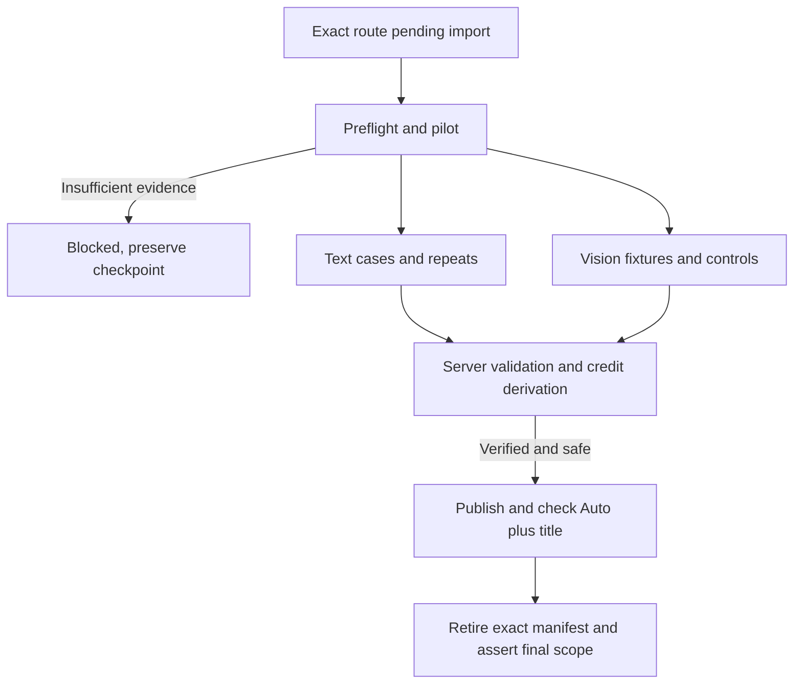

# P3 benchmark and cutover

**Status: BLOCKED.** Preflight alone is authorized up to USD 1 with zero retries; a billing ceiling could not be verified on the configured gateway. No inference, P3 catalog import, publication, retirement, or credit change was applied. The target remains 18 physical routes plus virtual Auto; zero routes have verified P3 evidence. Current legacy selectability is a separate measure.

## Reproduce

From the repository root with Bun and the existing server-side 9Router configuration:

```bash
bun src/server/core/p3-benchmark.ts --run p3-discovery --discover
bun src/server/core/p3-benchmark.ts --run p3-discovery --resume --discover
```

Without `--live`, the runner sends no inference. After approval, add `--live --max-calls N --max-tokens N` using the approved cumulative caps. Run `--stage preflight`, then `--stage pilot --resume`, then `--stage full --resume`. Use repeated `--route <exact-id>` flags for any subset or a future model, with a distinct `--run` name for each route list. Keep the same `--seed`, `--max-output`, and `--timeout` when resuming. `--deadline` is the wall-clock run limit in milliseconds; `--concurrency`, `--retries`, `--global-gap`, and `--provider-gap` bound requests. Exit 2 means blocked live coverage; exit 1 means invalid configuration or failed checkpoint. No fallback route is requested. An interrupted reservation still counts against both caps.

`test-results/p3/<run>/` contains the frozen manifest, append-only attempt journal, and JSON/CSV/Markdown reports. Keep this directory private and outside commits. Output and input reservation is a planning bound, not a verified billing measure. The gateway reports actual usage when available; pricing and routing provenance can remain unknown. A matching model field is gateway-reported identity, not independent upstream attestation.

Suite `zona-p3-v1`: 60 text cases per model (15/15/9/9/6/6), 24 additional text calls, 8 PNG cases, 4 visual repeats, 4 no-image controls, 1 preflight. No tools, shared transcript, or user data. Coding uses static checkable answers, not executable model code. Category scores weight each case equally; overall score weights categories by case count. Reports display two decimals; tier thresholds use raw scores (65/85), and catalog score is rounded to an integer. Credits are 3/6/15 from `CREDIT_COST_BY_BARS`. Retained calibration flags floor/ceiling or a range below five points; no threshold changes without approval. Repetition mean/range/agreement measure instability, not universal intelligence. Methods: [OpenAI eval practices](https://developers.openai.com/api/docs/guides/evaluation-best-practices), [Lighteval](https://huggingface.co/docs/lighteval/), [image input](https://developers.openai.com/api/docs/guides/images-vision).

## Discovery evidence

Discovery-only snapshot: `2026-11-23T03:08:44.876Z`; suite hash `d6ff39f7e6031f60827da37ee81b040f5c86b9a42d98a7d1b1dd89c15db490d5`. 0/1,818 planned calls; default total reservation 9,147,582 tokens before retries. Actual provider tokens/cost unknown. All routes: 0/60 valid, category/aggregate/bars/credit unknown, Vision not-tested, status BLOCKED.

| Exact route | Discovery | Connectivity | Scope |
|---|---|---|---|
| `gh/gpt-4.1` | listed | not-tested | retained |
| `gh/gpt-4o` | listed | not-tested | retained |
| `ag/gemini-3.8-flash-high` | listed | not-tested | retained |
| `atria/Atria-Dawn-Preview` | not listed | not-tested | retained |
| `nous/tencent/hy4-flash:free` | listed | not-tested | new |
| `cor-prod/deepseek-v4-1-flash-1017` | listed | not-tested | new |
| `cent-ai/qwen3.8-flash` | listed | not-tested | new |
| `ic-prod/mercury-3` | listed | not-tested | new |
| `zro-prod/zro/deepseek-v4.1-flash` | listed | not-tested | new |
| `nvidia/minimaxai/minimax-m3.1-flash` | listed | not-tested | new |
| `cx/gpt-6.2-sol` | listed | not-tested | new |
| `cx/gpt-6.1-sol` | listed | not-tested | new |
| `cx/gpt-6.1-terra` | listed | not-tested | new |
| `cx/gpt-6-luna` | listed | not-tested | new |
| `gcli/grok-4.7` | listed | not-tested | new |
| `cc/claude-opus-5-5` | listed | not-tested | new |
| `cc/claude-sonnet-5-5` | listed | not-tested | new |
| `tokenharbor/mimo-v2.6-flash:free` | listed | not-tested | new |

### USD 1 preflight readiness

Dry run `p3-preflight-usd1` (2026-11-23T06:59:43.559Z), manifest hash `743c7ac9050f9dae9d4a95c1fee95c27af130709fd4d9a0c779300919d0da868`. `GET /models` returned HTTP 200 and listed 17/18 exact routes without pricing or quota fields. The documented model-info lookup returned HTTP 404 for the sampled route. The runner enforces call/token reservations, not USD. With no verified gateway/provider hard limit or tariff upper bound, it sent 0/18 inference requests. No retries, pilot, or cutover ran. Resume this checkpoint with `--live` only once the USD 1 ceiling is enforceable; keep `--stage preflight --retries 0 --concurrency 1 --max-calls 18 --max-tokens 18000 --max-output 512 --timeout 20000 --deadline 420000 --resume`.

## Admin and P4 handoff

Use authenticated server operations in `src/server/functions/admin-models.ts`: `stageP3CatalogFn` uses P2 import for new pending entries, `publishAdminModelFn({data:{modelId,run}})` reads the trusted checkpoint on the server, `cutoverP3CatalogFn({data:'p3-catalog-v1'})` retires only the locked set in one transaction. Keep the report directory writable only by trusted operators; never accept report uploads. Stage/import does not make pending entries selectable. Publication recomputes scores and price from evidence, never accepts a browser-supplied rating, preserves inactive state, and is idempotent for the same run evidence. Review each retained model’s prior price in the audit metadata. Unknown capability does not enable a feature. Keep both DeepSeek route IDs separate; `cbai/deepseek-v4.1-flash` is a retirement target, not a fallback.



Do not start P4 before live evidence, isolated PostgreSQL, and cutover gates pass. Labels and lifecycle targets are in `src/lib/models/p3-manifest.ts`; live Vision/credit remain unknown. P9 browser QA: rerun chat single, credits, compare, model selection and image attachment journeys against the cut-over catalog.

Implementation commits: `ba34b19` (manifest), `6b6d4a0` (text scoring), `b53f5f7` (runner), `bbcf505` (Vision gate), `0c89591` (evidence and cutover), `eb16b27` (regressions).

Verification (each exit 0): `bun x tsc --noEmit`; `bun x biome check ./src` (207 files); `bun run build` (46s); focused Vitest (66 passed, 7.6s); isolated PostgreSQL admin/catalog (28 passed, 9.7s); isolated chat/compare/artifact and selector (50 passed, 26.4s); final SDK transport integration (2 passed, 0.81s). The initial runtime suite failed on missing `model_catalog`; rerunning against migrated isolated PostgreSQL exposed stale suffix IDs in compare fixtures. Those fixtures now use exact IDs without changing coverage or credit expectations. Synthetic test output is not live evidence.
