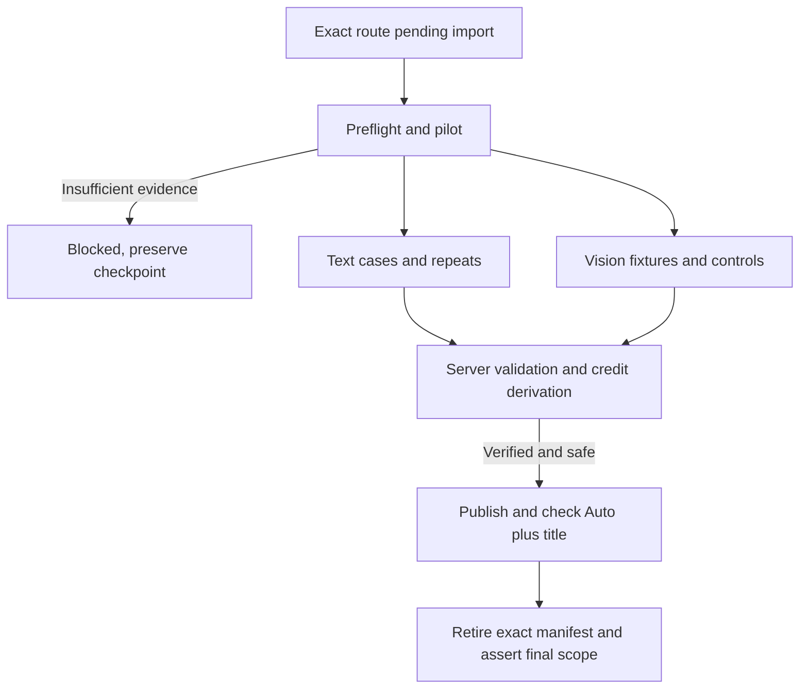

# P3 benchmark and cutover

**Status: BLOCKED.** Manifest `p3-catalog-v2` targets 17 physical routes plus virtual Auto. It adds Atria Dawn Preview to the 22-route retirement set without deleting its history. The authorized preflight ran once per route without retry; no route passed the exact-identity gate. Provider cost is unknown. No full benchmark, catalog import, publication, retirement, or credit change was applied.

## Reproduce

From the repository root with Bun and the existing server-side 9Router configuration:

```bash
bun src/server/core/p3-benchmark.ts --run p3-discovery --discover
bun src/server/core/p3-benchmark.ts --run p3-discovery --resume --discover
```

Without `--live`, the runner sends no inference. After approval, add `--live --max-calls N --max-tokens N` using the approved cumulative caps. Run `--stage preflight`, then `--stage pilot --resume`, then `--stage full --resume`. Use repeated `--route <exact-id>` flags for any subset or a future model, with a distinct `--run` name for each route list. Keep the same `--seed`, `--max-output`, and `--timeout` when resuming. `--deadline` is the wall-clock run limit in milliseconds; `--concurrency`, `--retries`, `--global-gap`, and `--provider-gap` bound requests. Exit 2 means blocked live coverage; exit 1 means invalid configuration or failed checkpoint. No fallback route is requested. An interrupted reservation still counts against both caps.

`test-results/p3/<run>/` contains the frozen manifest, append-only attempt journal, and JSON/CSV/Markdown reports. Keep this directory private and outside commits. Output and input reservation is a planning bound, not a verified billing measure. The gateway reports actual usage when available; pricing and routing provenance can remain unknown. A matching model field is gateway-reported identity, not independent upstream attestation.

Suite `zona-p3-v1`: 60 text cases per model (15/15/9/9/6/6), 24 additional text calls, 8 PNG cases, 4 visual repeats, 4 no-image controls, 1 preflight. No tools, shared transcript, or user data. Coding uses static checkable answers, not executable model code. Category scores weight each case equally; overall score weights categories by case count. Reports display two decimals; tier thresholds use raw scores (65/85), and catalog score is rounded to an integer. Credits are 3/6/15 from `CREDIT_COST_BY_BARS`. Retained calibration flags floor/ceiling or a range below five points; no threshold changes without approval. Repetition mean/range/agreement measure instability, not universal intelligence. Methods: [OpenAI eval practices](https://developers.openai.com/api/docs/guides/evaluation-best-practices), [Lighteval](https://huggingface.co/docs/lighteval/), [image input](https://developers.openai.com/api/docs/guides/images-vision).

## Discovery evidence

Discovery-only snapshot: `2026-11-23T03:08:44.876Z`; suite hash `d6ff39f7e6031f60827da37ee81b040f5c86b9a42d98a7d1b1dd89c15db490d5`. 0/1,818 planned calls; default total reservation 9,147,582 tokens before retries. Actual provider tokens/cost unknown. All routes: 0/60 valid, category/aggregate/bars/credit unknown, Vision not-tested, status BLOCKED.

| Exact route | Discovery | Connectivity | Scope |
|---|---|---|---|
| `gh/gpt-4.1` | listed | not-tested | retained |
| `gh/gpt-4o` | listed | not-tested | retained |
| `ag/gemini-3.8-flash-high` | listed | not-tested | retained |
| `atria/Atria-Dawn-Preview` | not listed | not-tested | retained |
| `nous/tencent/hy4-flash:free` | listed | not-tested | new |
| `cor-prod/deepseek-v4-1-flash-1017` | listed | not-tested | new |
| `cent-ai/qwen3.8-flash` | listed | not-tested | new |
| `ic-prod/mercury-3` | listed | not-tested | new |
| `zro-prod/zro/deepseek-v4.1-flash` | listed | not-tested | new |
| `nvidia/minimaxai/minimax-m3.1-flash` | listed | not-tested | new |
| `cx/gpt-6.2-sol` | listed | not-tested | new |
| `cx/gpt-6.1-sol` | listed | not-tested | new |
| `cx/gpt-6.1-terra` | listed | not-tested | new |
| `cx/gpt-6-luna` | listed | not-tested | new |
| `gcli/grok-4.7` | listed | not-tested | new |
| `cc/claude-opus-5-5` | listed | not-tested | new |
| `cc/claude-sonnet-5-5` | listed | not-tested | new |
| `tokenharbor/mimo-v2.6-flash:free` | listed | not-tested | new |

### Live preflight

Run `p3-preflight-v2-usd1` completed at `2026-11-23T09:12:08.858Z`, manifest hash `5882a65401d7bb522e389914ec2027c2bf35285885768676beb723d117de065d`. The checkpoint name predates the authorization to run preflight with unknown USD cost. Discovery had listed all 17 targets. The runner made 17 requests with no retries, reserved 15,028 tokens, and observed 5,569 reported tokens across five calls. The other 12 did not report usage to the runner. Cost remains unknown. Exit 2 indicates missing full-suite coverage; no text benchmark, repeats, or Vision cases ran.

| Exact route | Preflight outcome | Reported model | Latency (ms) |
|---|---|---|---:|
| `gh/gpt-4.1` | SDK rejected response (HTTP 200) | unknown | 1655 |
| `gh/gpt-4o` | SDK rejected response (HTTP 200) | unknown | 1189 |
| `ag/gemini-3.8-flash-high` | SDK rejected response (HTTP 200) | unknown | 4322 |
| `nous/tencent/hy4-flash:free` | SDK rejected response (HTTP 200) | unknown | 4397 |
| `cor-prod/deepseek-v4-1-flash-1017` | SDK rejected response (HTTP 200) | unknown | 971 |
| `cent-ai/qwen3.8-flash` | SDK rejected response (HTTP 200) | unknown | 2250 |
| `ic-prod/mercury-3` | SDK rejected response (HTTP 200) | unknown | 861 |
| `zro-prod/zro/deepseek-v4.1-flash` | SDK rejected response (HTTP 200) | unknown | 1973 |
| `nvidia/minimaxai/minimax-m3.1-flash` | SDK rejected response (HTTP 200) | unknown | 1509 |
| `cx/gpt-6.2-sol` | Correct answer; identity mismatch | `gpt-6.2-sol` | 1750 |
| `cx/gpt-6.1-sol` | Correct answer; identity mismatch | `gpt-6.1-sol` | 1706 |
| `cx/gpt-6.1-terra` | Correct answer; identity mismatch | `gpt-6.1-terra` | 1846 |
| `cx/gpt-6-luna` | Correct answer; identity mismatch | `gpt-6-luna` | 2585 |
| `gcli/grok-4.7` | Correct answer; identity mismatch | `grok-4.7` | 19355 |
| `cc/claude-opus-5-5` | SDK rejected response (HTTP 200) | unknown | 1730 |
| `cc/claude-sonnet-5-5` | SDK rejected response (HTTP 200) | unknown | 1360 |
| `tokenharbor/mimo-v2.6-flash:free` | SDK rejected response (HTTP 200) | unknown | 12060 |

The five correct answers returned bare model IDs, not the requested exact routes. The other responses were recorded as `http-rejected` with status 200; the journal did not retain their body, so the cause is unknown. Request IDs were recorded for five calls; none reported a gateway version. Inspect gateway logs for the rejected responses and verify the bare ID mapping before requesting approval for any additional inference.

Read-only 9Router log correlation: in the preflight window, eight usage records matched the application key and target model names. Four were logged under `codex`, one under `grok-cli`, one under `antigravity`, and two under `claude`. This supports the provider mapping for the five bare IDs, but the usage records do not tie individual runner request IDs to gateway responses. For three SDK-rejected responses, 9Router logged successful upstream usage. No request detail rows were retained in that window, so the response parsing failure remains undiagnosed. No inference was repeated.

Executed command (historical; do not rerun without separate authorization):

```bash
bun src/server/core/p3-benchmark.ts --run p3-preflight-v2-usd1 --stage preflight --retries 0 --concurrency 1 --max-calls 17 --max-tokens 18000 --max-output 512 --timeout 20000 --deadline 420000 --resume --live
```

Two additional diagnostic calls ran without retry. `gh/gpt-4.1` returned HTTP 200 with `Content-Type: text/event-stream` and a non-JSON body to the non-streaming SDK request. This explains the SDK rejection for this probe only. `cx/gpt-6.2-sol` returned valid JSON with a bare model ID again, so exact-route provenance remains unverified. Sanitized wire metadata is local at `test-results/p3/diagnostics-two/`. No full-suite cases ran. The two probes reported 781 tokens for one call; remaining usage and USD cost are unknown.

## Admin and P4 handoff

Use the authenticated operations in `src/server/functions/admin-models.ts`: `stageP3CatalogFn` imports new pending entries, `publishAdminModelFn({data:{modelId,run}})` validates the trusted server checkpoint, and `cutoverP3CatalogFn({data:'p3-catalog-v2'})` retires only the manifest set in one transaction. Keep the report directory writable only by trusted operators; never accept report uploads. Pending entries are not selectable. Publication derives scores and prices from evidence, preserves inactive state, and is idempotent for the same evidence. Review prior prices in the audit metadata. Unknown capabilities stay disabled. Keep the two new DeepSeek routes separate; the old DeepSeek route and Atria remain resolvable for history after retirement.



Do not start P4 before live evidence, isolated PostgreSQL, and cutover gates pass. Labels and lifecycle targets are in `src/lib/models/p3-manifest.ts`; live Vision/credit remain unknown. P9 browser QA: rerun chat single, credits, compare, model selection and image attachment journeys against the cut-over catalog.

Implementation commits: `ba34b19` (manifest), `6b6d4a0` (text scoring), `b53f5f7` (runner), `bbcf505` (Vision gate), `0c89591` (evidence and cutover), `eb16b27` (regressions).

Verification (each exit 0): `bun x tsc --noEmit`; `bun x biome check ./src` (207 files); `bun run build` (46s); focused Vitest (66 passed, 7.6s); isolated PostgreSQL admin/catalog (28 passed, 9.7s); isolated chat/compare/artifact and selector (50 passed, 26.4s); final SDK transport integration (2 passed, 0.81s). The initial runtime suite failed on missing `model_catalog`; rerunning against migrated isolated PostgreSQL exposed stale suffix IDs in compare fixtures. Those fixtures now use exact IDs without changing coverage or credit expectations. Synthetic test output is not live evidence.
