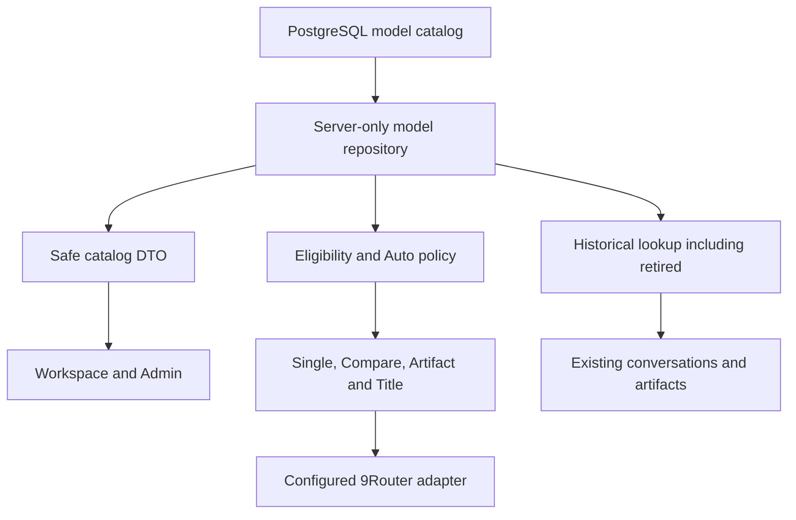

# P1 — Dynamic Model Catalog Foundation

**Kompleksitas:** COMPLEX — arsitektur, database, AI orchestration  
**Dependency:** Tidak ada; fondasi P2–P3  
**Tujuan:** Eksekusi hanya fase P1 terhadap [Zona.ai](http://Zona.ai), bukan membuat rencana tanpa implementasi.

## Konteks dan masalah yang harus diselesaikan

Pada snapshot referensi, `src/lib/models/registry.ts` adalah array statis 26 entri (25 model + Auto). `src/routes/admin/models.tsx` mengimpor array itu secara langsung. `model_settings` di `src/lib/db/schema.ts` hanya menyimpan isActive, disabledReason dan updatedBy, bukan katalog lengkap. `getModelById`, `isVisionCapable`, `getModelCatalog` dan `getAvailableModels` membuat chat/compare/artifact bergantung pada source code; `models/router.ts` menyebut model ID secara eksplisit; `lib/chat/title.ts` membaca ID lightweight dari Auto. `getModelOverridesMap` mem-cache override di proses, `isModelAvailable` default true ketika tidak ditemukan. `useModelCatalog.ts` mencocokkan suffix dan memiliki promise cache yang dapat stale. Semua ini bertentangan dengan kemampuan tambah/hapus model tanpa redeploy.

Keputusan produk: [Zona.ai](http://Zona.ai) mengimpor model yang sudah ada di 9Router (bukan mengonfigurasi provider 9Router). Katalog PostgreSQL menjadi source of truth. Hapus berarti retire dari pilihan aktif; percakapan/generation/artifact/credit/audit lama tetap utuh. Auto adalah virtual router yang tetap ada, tidak diperlakukan seperti model biasa. Route berbeda tetap selectable secara independen, termasuk DeepSeek. Kredit tetap flat per generation, bukan token billing. Penilaian model baru dan Vision harus berbasis benchmark P3. **Fase ini belum menghapus model lama, belum impor 14 model, belum bikin UI CRUD.**

## 1. Audit dependency dan tetapkan kontrak

Search seluruh referensi registry, model ID literal, alias, `endsWith`, provider detection, catalog server functions, `getModelById`, `isModelAvailable`, `resolveAutoModel`, `isVisionCapable`, creditCost, title, artifact retry/revision, preference, conversation hydration, admin metrics, cache, model selector dan tests. Baca producer/consumer nyata, termasuk streaming stop/refund dan path penggunaan metadata untuk history. Bedakan lookup display historis dari lookup model yang dapat dipakai inference. Tulis inventory dampak dan rencana migrasi kecil. Jangan menghapus compatibility entry sebelum semua caller dimigrasi.

## 2. Database dan migration yang tidak merusak data

Buat schema/Drizzle migration versioned untuk katalog dinamis (nama tabel/kolom mengikuti konvensi repo). Minimal mendukung:

- Stable internal `id` unik, exact `routerModelId` unik untuk model fisik; jangan lowercase/truncate/split sembarangan atau membuang `:free`, `/`, `.`, kapitalisasi.
- displayName, vendor vs gateway/provider route yang dibedakan, description, search aliases, capability metadata; contextWindow/maxOutput/pricing nullable jika tidak diketahui; provenance sumber/tanggal untuk metadata.
- availability administratif (active/inactive/retired) dan status validasi/evaluation (pending/verified/failed/inconclusive sesuai kontrak yang jelas); alasan nonaktif, waktu retire, actor/timestamp, last checked. Jangan menyamakan admin-disabled dengan gateway error.
- Rating text score nullable, bands 2/3/4 nullable, tier/credit cost nullable untuk model belum dinilai; Vision tri-state atau enum yang membedakan supported/unsupported/unverified/inconclusive/not-tested, plus evidence ref. Evaluasi bertanggal dan versi suite. Jika bentuk schema berbeda, tetap pertahankan semantik ini.
- Simpan explicit alias map/identity migration untuk internal ID lama yang berbeda dari route (contoh `gpt-5.6-sol` → `cx/gpt-5.6-sol`, `qwen3.8-flash` → `bai/qwen3.8-flash`). Hanya alias yang dibuktikan dari registry. Konflik/duplikasi harus ditolak atau diatasi eksplisit; tidak pakai suffix matching untuk dua route bernama sama.
- Reuse atau migrasikan `model_settings` menjadi satu sumber status; tidak boleh ada dua sumber availability yang saling bertentangan. Preserve override nonaktif/alasan/updatedBy berdasarkan ID kanonik. Orphan settings yang tidak bisa dipetakan harus dilaporkan/disimpan sebagai historical evidence, bukan mempengaruhi model lain.
- Seed/migrate **semua 25 model lama** dengan data yang tersedia dan Auto virtual. Seed idempotent; tidak mengaktifkan ulang model yang pernah disabled, tidak overwrite admin changes saat rerun, tidak menganggap metadata legacy sebagai hasil benchmark baru. Auto dapat tetap menjadi satu virtual entry dengan kontrak eksplisit, bukan row physical yang bisa dihapus. Legacy rating boleh dipertahankan sementara dengan provenance legacy; P3 re-evaluasi empat model yang dipertahankan. Pisahkan metadata lama dari verified baru.
- Jangan cascade delete ke messages, conversations, generation_runs, artifact_versions, credit_transactions, usage_records dan audit_logs. Hindari migration yang menghapus/rewrite historical route atau saldo. Jalankan migrasi di DB isolated, cek row count/identity/status before-after melalui test/migration checks; jangan edit DB aplikasi secara manual. Jika target deployment belum dimigrasi, sediakan instruksi migrasi dan rollback yang aman (tidak membuang data baru), bukan mengklaim sudah deployed.

## 3. Repository server-only dan kontrak client

Buat central repository untuk list/find by canonical ID/exact route, lookup historis termasuk retired, resolve eligible models. Gunakan typed query dan schema validation. Semua path inference harus fail closed untuk unknown/retired/inactive atau catalog unavailable (jangan fallback statis diam-diam, jangan default unknown menjadi active). Model pending baru tidak bisa dipakai publik. UI hanya menerima DTO aman melalui server functions; provider secret dan gateway credential tetap server-only. Jangan import DB module dalam bundle client. Jika asynchronous lookup memerlukan perubahan signature, update semua caller secara konsisten.

Buat cache/invalidation yang mengikuti lifecycle dan tidak menyimpan promise resolved selamanya. Tentukan strategi lintas proses (DB read untuk keputusan otoritatif, atau invalidasi lintas instance dengan batas freshness yang jelas; jangan mengandalkan process cache sebagai authorization). TanStack Query key katalog untuk client, refetch saat perubahan yang relevan/focus atau TTL yang terukur, tidak menyembunyikan error jadi empty-success. Pada fase ini siapkan kontrak list yang memungkinkan pagination P7; workspace tetap dapat mengambil katalog publik lengkap. Jangan mem-paginate dropdown model selector dengan pagination halaman admin.

## 4. Auto Router, title, credit dan history

- Pindahkan kandidat hardcoded di `models/router.ts` ke policy/config berbasis katalog. Pertahankan klasifikasi prompt lightweight/coding/reasoning dan behavior cost-aware; gunakan kemampuan, skor/domain evaluation, tier, availability, saldo, dan requirement input dari caller. Routing legacy sementara menggunakan metadata yang sudah ada, diberi provenance. Jangan perkenalkan ID baru di UI atau runtime. Bila tidak ada kandidat valid, tampilkan domain error actionable sebelum debit/inference; tidak mencoba retired model sebagai last resort.
- Auto harus menyelesaikan physical route sekali per generation, menyimpan actual route, memakai tarif aktual dari model pilihan yang valid, dan menghormati budget. Auto tidak diberi intelligence bars seolah model fisik; nilai kredit adaptif/policy-derived, bukan hardcoded angka 1. Vision/attachment eligibility Auto harus berdasarkan kandidat nyata untuk request tersebut, tidak menjanjikan capability universal. Compare tetap 2–4, tanpa Auto dan duplikat exact identity. No silent provider reroute dalam Compare/retry.
- `chat/title.ts`: gunakan lightweight eligible router policy; fallback judul lokal existing bila gagal, tidak merusak main response. Jangan campur model embedding RAG sebagai model chat/title.
- Trace single chat, compare, retry/stop, artifact create/revise/compare/retry, attachment capability guards. Retired model tidak boleh menjalankan request baru; historical conversation yang modelnya retired tetap dapat dibuka/read/copy/download, label tidak berubah menjadi Auto. Jika pengguna mau melanjutkan, arahkan pilih model yang aktif secara eksplisit; default preference yang obsolete dapat fallback Auto secara jelas tanpa mengubah generation historis. In-flight generation dan refund/settlement gunakan snapshot/ledger saat start, bukan biaya terkini atau lookup active yang mungkin hilang.
- Admin dashboard `disabledModelsCount` harus menghitung status yang sesuai dengan definisi katalog; pertahankan semantik inactive dan jangan menghitung retired sebagai gangguan. Preserve audit ID.

## Visualisasi target arsitektur (bukan desain UI baru)

```

```

```
Model admin state     Evaluation           Eligible for new generation?
Active legacy         legacy               existing behavior until P3
Active verified       verified             yes, if available/capable
Inactive              any                  no
Retired               any                  no, historical lookup only
New pending           pending/inconclusive no
```

## 5. Acceptance dan regression tests

- Migration preserves existing user/credit/chat/artifact/audit data, initial counts (25 physical models + Auto), exact aliases, disabled states and rerun stability.
- Two routes with the same basename stay distinct in lookup, overrides, selection, rate/cost and history. Unknown/retired ID rejected for new generation before credits or provider call. Admin/non-admin boundary intact. DB failure fails closed for new inference.
- Single chat, compare, retry/stop, artifact create/revise, credit refund, default model preference, history hydration, title fallback, selection/capability regressions pass with isolated DB and controlled gateway fixtures.
- Auto policy chooses only eligible affordable candidates, handles all candidates disabled, and records resolved route and cost. No runtime static model-array source of truth or hardcoded candidate list left; only one-time migration/legacy mapping and synthetic test fixtures may contain old IDs. Report exact remaining references and why intentional.
- Server build/typecheck proves no client-only import of DB or secrets. Existing UI may be retained, but catalog data comes through server boundary. No CRUD UI, no benchmark results claimed, no browser QA in P1.

Handoff P2: schema and migration location, server contracts, compatibility IDs, status/evaluation semantics, stale-cache strategy, how to create/retire model, test outputs, unresolved blockers. Do not start P2 until foundation gates pass.

Referensi teknis: [https://orm.drizzle.team/docs/migrations](https://orm.drizzle.team/docs/migrations) ; [https://tanstack.com/query/latest/docs/framework/react/guides/query-invalidation](https://tanstack.com/query/latest/docs/framework/react/guides/query-invalidation) ; [https://github.com/decolua/9router/blob/master/gitbook/content/en/integration/other-tools.md](https://github.com/decolua/9router/blob/master/gitbook/content/en/integration/other-tools.md) . Verifikasi versi aktual sebelum memakai API.

## Aturan eksekusi dan integritas (wajib)

- Bekerja pada branch kerja yang diberikan di repository `ghazyAlghifari508/zona-ai`. Snapshot referensi laporan: `7c4962c8ae0b36988be0c7543f1f2c95f8753111`; baca HEAD aktual, diff, git status dan dependency sebelum mengubah apa pun. Jangan reset, stash, overwrite, atau menghapus pekerjaan user/agent lain tanpa izin. Jangan menganggap line number dan struktur lama masih sama.
- Baca [`AGENTS.md`](http://AGENTS.md), [`DESIGN.md`](http://DESIGN.md), semua `.agents/rules/` (context, no-assumptions, no-hardcode, no-type-bypass, bounded-processes, anti-ai-slop, skills-mcp) dan handoff fase sebelumnya. Ikuti stack aktual Bun, TanStack Start/Router/Query, React, Tailwind v4, Drizzle/PostgreSQL, AI SDK, Better Auth. Jangan mengganti framework, auth, gateway, atau desain global. [DESIGN.md](http://DESIGN.md) + token aktual Notion-inspired mengatur tampilan; konflik dokumentasi MindMarket lama jangan dijadikan alasan mengembalikan palet lama.
- Discover dan invoke skill yang tersedia sesuai aturan repo (process/brainstorming atau systematic-debugging, writing-plans, TDD, implementation skill relevan, verification-before-completion). Gunakan dokumentasi resmi versi paket terpasang/Context7 bila tersedia. Jangan mengarang nama skill, tool, endpoint, atau hasil pemanggilan. Jangan membuka scope atau meminta ulang keputusan produk yang sudah dikunci. Laporkan blocker nyata dengan bukti.
- Trace seluruh caller dan data boundary sebelum perubahan. Gunakan Zod di trust boundary, strict TypeScript, tidak `any`, `as never`, `@ts-ignore`, non-null assertion atau cast untuk menyembunyikan bug; gunakan narrowing yang benar. Server-only secrets; tidak mengubah `.env` asli, mencetak credential, atau menaruh data privat di fixture/log/commit.
- TDD untuk invariant deterministik: reproduksi/failing test yang relevan, implementasi akar masalah, rerun, regression test. Jangan menghapus, skip, mute, downgrade assertion, mengganti expected result untuk membenarkan bug, memalsukan exit code, menyeleksi test yang hanya hijau, mengganti runtime asli dengan mock agar klaim berhasil, atau memodifikasi konfigurasi test/coverage untuk menyembunyikan kegagalan. Mock terkontrol boleh untuk unit test, bukan bukti integrasi nyata. Untuk evaluasi model (P3), rubric/ground truth benchmark terpisah dari unit test aplikasi; jangan menambah assertion atas prose AI stokastik ke unit test.
- Dilarang manipulasi database untuk membuat tes lulus: jangan mengedit status/balance/hasil evaluasi lewat SQL manual, mereset DB user, menghapus history, mematikan constraint, atau menyisipkan record palsu ke DB aplikasi. Migration/seed resmi, fixture sintetis melalui harness dan database test terisolasi diperbolehkan dengan cleanup terukur; jangan pakai data produksi untuk test destruktif. Buktikan env test terpisah tanpa menampilkan kredensial. Jika DB/test dependency tidak tersedia, laporkan BLOCKED; jangan klaim PASS.
- Setiap proses finite harus mempunyai deadline eksplisit sesuai bounded-processes repo (inspeksi 15–30s, focused gate 60–120s, install/build 2–5 menit, full gate 10 menit awal; sesuaikan secara beralasan). Jangan menjalankan dev server foreground yang tidak berakhir. Jika butuh service untuk integration test, managed lifecycle, readiness deadline, cleanup di finally, verifikasi PID/port; di Windows hentikan hanya verified process tree, bukan seluruh Bun/Node. Timeout bukan pass; investigasi sebelum retry.
- Jalankan `bun x tsc --noEmit`, `bun x biome check ./src`, test Vitest terdampak beserta regression domain terkait, dan build apabila perubahan memengaruhi bundling/migration/route. Laporkan perintah, exit code, jumlah test, durasi, kegagalan, blocker. Jangan mengabaikan bug baru: reproduce, klasifikasikan; regression scope ini wajib diperbaiki dengan test, bug independen dokumentasikan lokasi/bukti/impact dan jangan menutupinya. Jika blocker membuat acceptance tidak terpenuhi, jangan lanjut ke fase berikutnya atau menyebut Done. Jangan mengerjakan fase berikutnya dalam prompt ini.
- Commit kecil atomik dengan Conventional Commits setelah gate yang relevan lulus, tanpa menyertakan credential, file privat, atau unrelated diff. Jangan push/merge/deploy tanpa instruksi. Akhiri dengan daftar file, commit SHA, keputusan, bukti test dan status PASS/FAIL/BLOCKED per acceptance, daftar deferred gate dan handoff yang cukup untuk fase berikutnya.
- **Browser QA ditunda ke P9.** Jangan buka aplikasi untuk review visual, jangan jalankan Playwright E2E/browser automation, screenshot QA, atau visual-companion browser pada fase ini. Riset dokumentasi/registry komponen melalui web/MCP tetap wajib untuk frontend dan bukan Browser QA. Unit/component/integration test non-browser tetap wajib. Catat E2E yang perlu dijalankan di P9, jangan hapus atau weaken test tersebut.