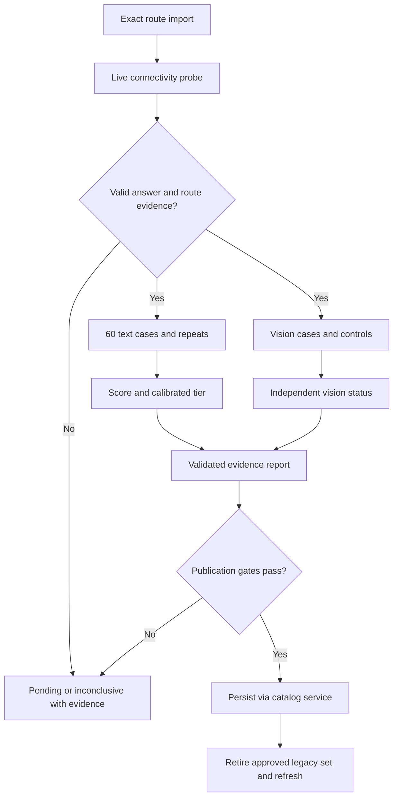

# P3 — Model Migration, Intelligence Benchmark, Vision Verification & Credit Calibration

**Kompleksitas:** VERY COMPLEX — live gateway, benchmark, data migration  
**Dependency:** P1 dan P2 lulus; gateway dan anggaran pengujian tersedia  
**Tujuan:** Eksekusi hanya fase P3 terhadap [Zona.ai](http://Zona.ai), bukan membuat rencana tanpa implementasi.

## Objective dan keputusan yang tidak boleh berubah

Ganti katalog lama sesuai daftar berikut tanpa merusak histori. Gunakan jalur import P2, repository/policy P1, model ID persis seperti diberikan. Evaluasi aktual **18 model fisik final** (14 baru + 4 lama yang dipertahankan), secara independen per exact route melalui 9Router yang dipakai [Zona.ai](http://Zona.ai). Jangan memberi skor, capability Vision, atau tarif berdasarkan nama, reputasi, klaim model, label `free`, atau asumsi versi. Auto adalah router virtual dan tidak masuk benchmark intelligence. Buat runner reusable untuk model yang ditambahkan kemudian. Jangan melakukan perubahan UI global P4–P8 di sini.

## 1. Manifest migrasi yang dikunci

Empat model yang dipertahankan (internal ID/route sama):


| Model                   | Exact routerModelId        |
| ----------------------- | -------------------------- |
| GPT 4.1                 | `gh/gpt-4.1`               |
| GPT-4o                  | `gh/gpt-4o`                |
| Gemini 3.8 Flash (High) | `ag/gemini-3.8-flash-high` |
| Atria Dawn Preview      | `atria/Atria-Dawn-Preview` |


21 model fisik yang harus di-retire (bukan hard delete):


| Model                    | ID legacy di registry                | Exact route legacy                   |
| ------------------------ | ------------------------------------ | ------------------------------------ |
| GPT 5.6 Terra            | `cx/gpt-5.6-terra`                   | `cx/gpt-5.6-terra`                   |
| GPT 5.6 Luna             | `cx/gpt-5.6-luna`                    | `cx/gpt-5.6-luna`                    |
| GPT 5.6 Sol              | `gpt-5.6-sol`                        | `cx/gpt-5.6-sol`                     |
| GPT 5.5                  | `cx/gpt-5.5`                         | `cx/gpt-5.5`                         |
| GPT 5.4                  | `cx/gpt-5.4`                         | `cx/gpt-5.4`                         |
| Gemini 3.7 Flash High    | `ag/gemini-3.7-flash-high`           | `ag/gemini-3.7-flash-high`           |
| Gemini 3.7 Flash Low     | `ag/gemini-3.7-flash-low`            | `ag/gemini-3.7-flash-low`            |
| Gemini 3.6 Flash High    | `ag/gemini-3.6-flash-high`           | `ag/gemini-3.6-flash-high`           |
| Gemini 3.1 Pro           | `ag/gemini-pro-agent`                | `ag/gemini-pro-agent`                |
| Claude Opus 4.6 Thinking | `ag/claude-opus-4-6-thinking`        | `ag/claude-opus-4-6-thinking`        |
| Claude Sonnet 4.6        | `ag/claude-sonnet-4-6`               | `ag/claude-sonnet-4-6`               |
| Grok 4.6                 | `gcli/grok-4.6`                      | `gcli/grok-4.6`                      |
| Grok 4.5                 | `gcli/grok-4.5`                      | `gcli/grok-4.5`                      |
| Qwen 3.8 Flash           | `qwen3.8-flash`                      | `bai/qwen3.8-flash`                  |
| MiMo V2.5                | `mimo-v2.5`                          | `bai/mimo-v2.5`                      |
| HY3                      | `hy3`                                | `bai/hy3`                            |
| GLM 5.3 Flash            | `glm-5.3-flash`                      | `bai/glm-5.3-flash`                  |
| Grok 4.7 High            | `gcli/grok-4.7-high`                 | `gcli/grok-4.7-high`                 |
| Muse Spark 1.2 Free      | `oc/muse-spark-1.2-contributor-free` | `oc/muse-spark-1.2-contributor-free` |
| Muse Spark 1.3 Free      | `oc/muse-spark-1.3-contributor-free` | `oc/muse-spark-1.3-contributor-free` |
| DeepSeek V4.1 Flash lama | `cbai/deepseek-v4.1-flash`           | `cbai/deepseek-v4.1-flash`           |


14 model baru; display name di bawah hanya usulan label yang harus dicek dengan metadata resmi jika tersedia, bukan pernyataan capability:


| Suggested display name | Exact 9Router model ID                |
| ---------------------- | ------------------------------------- |
| HY4 Flash              | `nous/tencent/hy4-flash:free`         |
| DeepSeek V4.1 Flash    | `cor-prod/deepseek-v4-1-flash-1017`   |
| Qwen 3.8 Flash         | `cent-ai/qwen3.8-flash`               |
| Mercury 3              | `ic-prod/mercury-3`                   |
| DeepSeek V4.1 Flash    | `zro-prod/zro/deepseek-v4.1-flash`    |
| MiniMax M3.1 Flash     | `nvidia/minimaxai/minimax-m3.1-flash` |
| GPT 6.2 Sol            | `cx/gpt-6.2-sol`                      |
| GPT 6.1 Sol            | `cx/gpt-6.1-sol`                      |
| GPT 6.1 Terra          | `cx/gpt-6.1-terra`                    |
| GPT 6 Luna             | `cx/gpt-6-luna`                       |
| Grok 4.7               | `gcli/grok-4.7`                       |
| Claude Opus 5.5        | `cc/claude-opus-5-5`                  |
| Claude Sonnet 5.5      | `cc/claude-sonnet-5-5`                |
| MiMo V2.6 Flash        | `tokenharbor/mimo-v2.6-flash:free`    |


Auto tetap ada. Target catalogue scope: 26 awal - 21 retired + 14 baru = **19 entri (18 fisik + Auto)**, excluding retired dan tanpa menggabungkan dua DeepSeek. Jumlah selectable aktual dapat kurang bila ada model pending/disabled/failed. Jangan mengaktifkan model nonaktif lama diam-diam. Jangan menghapus entri tambahan yang dibuat user setelah snapshot tanpa konfirmasi; laporkan drift scope. Jangan mengubah provider account, quota, konfigurasi 9Router, atau fallback antar-route diam-diam. DeepSeek lama cbai harus retired, bukan fallback tersembunyi.

## 2. Runner evaluasi reusable, bukan penilaian vibe

Buat CLI/script Bun/TypeScript yang menggunakan gateway config dan adapter aktual. Sediakan manifest suite versioned, model list configurable, seed, per-case timeout, max concurrency, max retries, max calls/token budget, resume/checkpoint, dry-run (tidak inference), output laporan JSON/CSV/Markdown, serta cara menjalankan satu model atau subset. Nama command/file tentukan sesuai struktur repo; dokumentasikan perintah eksekusi aktual, jangan mengarang command yang tidak dibuat. Runner tidak memanggil model dari browser atau melalui user credit ledger. Jangan menggunakan OAuth/session credential di luar jalur gateway yang telah dikonfigurasi.

Sumber metodologi: [https://developers.openai.com/api/docs/guides/evaluation-best-practices](https://developers.openai.com/api/docs/guides/evaluation-best-practices) ; [https://huggingface.co/docs/lighteval/](https://huggingface.co/docs/lighteval/) ; [https://developers.openai.com/api/docs/guides/images-vision](https://developers.openai.com/api/docs/guides/images-vision) . Cek dokumentasi versi SDK/gateway aktual. Task-specific tests, ground truth, executable evaluators, repeatability; jangan menyebut skor sebagai universal IQ atau benchmark resmi industri.

- Preflight test 18 exact routes melalui configured 9Router. Catat listing/discovery jika tersedia, request ID, exact requested route, response-reported model/route bila tersedia, gateway version/config yang relevan tanpa secrets, valid final answer, latency/time, error. Listing saja bukan bukti inference; response ID yang berbeda perlu dianalisis, jangan menyebutnya endpoint identity terverifikasi jika gateway tidak mengekspos provenance. Tidak boleh mengirim request ke route lain jika route gagal. Catat jika gateway sendiri melakukan fallback atau identitas tidak bisa dipastikan; hasil dengan mismatch tidak dianggap bukti route yang diminta.
- Gunakan suite versioned yang sama untuk semua 18 route; freeze cases/ground truth/rubric/threshold & parameter policy sebelum melihat hasil. Data sintetis/nonprivat dan memiliki jawaban yang bisa diperiksa. Jangan menggunakan real user chats atau benchmark answer bocor di prompt. Satu case = satu independent context; system prompt netral sama; web search/RAG external tools off untuk baseline, kecuali case menguji konteks yang memang diberikan sama. No cross-model history/answer contamination.
- Pakai sampling yang sedekat mungkin setara dan didukung route, max output/wall-time wajar untuk reasoning; temperature/settings yang tidak didukung dicatat, jangan memalsukan kesetaraan. Jangan memberikan budget token yang membuat output model reasoning selalu terpotong. Pisahkan fairness policy dari keterbatasan provider.
- Minimal **60 case unik per model** (enam kategori di bawah, per kategori variasi easy/medium/hard, edge cases dan output yang deterministik bila memungkinkan). 60 × 18 = 1.080 case dasar sebelum probes, vision, retry dan repetition. Ini bukan instruksi membanjiri provider dengan request. Preflight, pilot terukur, estimasi calls/tokens/cost, jalankan hanya dalam anggaran yang diotorisasi, default concurrency kecil (misal 1–2), rate limit per provider dan global. Respect Retry-After dan stop pada auth/limit repeated, checkpoint/resume. Jangan menghabiskan biaya tak disetujui. Jika tidak cukup budget, laporkan partial coverage & BLOCKED, jangan menurunkan standar minimal secara diam-diam.
- Pengulangan pada subset yang telah dipilih sebelum hasil (minimal 2 case per kategori, tiga percobaan total pada subset sebagai default usulan; catat variasi, agreement/score mean/range; jangan memilih best-of-n). Rencana minimal ini menambah 24 calls per model di luar 60 case. Laporkan planned vs executed calls dan actual tokens kalau tersedia. Latency diukur terpisah, bukan otomatis ukuran kecerdasan.

## 3. Benchmark kecerdasan teks: distribusi dan bobot

Gunakan 60 case = 15 coding, 15 logical reasoning, 9 mathematics, 9 instruction following, 6 factual accuracy, 6 context understanding. Bobotnya sama dengan proporsi. Gunakan cases baru secara independen atau dataset publik berlisensi dengan ground truth dan provenance; jangan mengutip materi berhak cipta secara berlebihan atau menyalin private data.


| Kategori              | Bobot | Contoh tipe tugas                                                                    | Scoring                                                                                 |
| --------------------- | -----: | ------------------------------------------------------------------------------------ | --------------------------------------------------------------------------------------- |
| Coding                | 25%   | Debug snippet, implement pure function, algorithm edge cases, SQL read-only fixture  | Parse/extract answer, tests terhadap fungsi pada isolated sandbox, deterministic rubric |
| Logical reasoning     | 25%   | Constraint puzzle, deduksi multi-step, conditional reasoning                         | Jawaban final/checkable constraints                                                     |
| Mathematics           | 15%   | Aritmetika, aljabar, persentase, probabilitas                                        | Numeric tolerance/normalized exact or verified formula                                  |
| Instruction following | 15%   | JSON schema, field requirements, transforms, multi-constraint response               | Schema/parser and deterministic constraint checks                                       |
| Factual accuracy      | 10%   | Stable verified facts, grounded question, knowing insufficient evidence              | Ground truth/sourced rubric; jangan menilai fakta terbaru tanpa source                  |
| Context understanding | 10%   | Dokumen sintetis, referensi lintas paragraf, distractor, contradiction, unanswerable | Extracted factual answer/evidence and rubric                                            |


Contoh case (bukan seluruh suite):

```
Input: Pesanan A selesai sebelum B, C tidak boleh pertama, B sebelum C.
      Susun urutan A, B, C yang memenuhi seluruh aturan.
Expected: A, B, C (normalize valid equivalent notation).
Scorer: verifikasi urutan dan semua constraint; bukan panjang jawaban.
```

Coding eval: jangan menjalankan arbitrary code hasil model dengan akses host, network, filesystem user, env, credential, atau production DB. Gunakan sandbox benar-benar terisolasi dan resource-limited serta allowlisted task harness; jika sandbox aman tidak tersedia gunakan static/checkable outputs atau review rubric konservatif dan laporkan keterbatasan. Jangan menjalankan shell yang diberikan model.

Setiap case memiliki ID, category, difficulty, source/seed, expected answer/constraints, scoring method, pass/partial/fail rule dan output parser. Ground truth scoring utama; jika butuh subjective rubric gunakan penilaian independen/blind, rubric spesifik, verifikasi manual untuk borderline; tidak hanya self-rating model atau satu AI judge yang tidak dikalibrasi. Jangan menjadikan panjang, gaya, reasoning verbosity, atau format prose sebagai bukti kecerdasan; hanya functional requirement yang relevan.

## 4. Score, bars, tier dan kredit (skema tidak diganti)

Hitung kategori `100 × sum(casePoints) / sum(maxPoints)` untuk valid complete set; score = 0,25 coding + 0,25 reasoning + 0,15 math + 0,15 instruction + 0,10 factual + 0,10 context. Laporkan score dengan metodologi pembulatan terdefinisi; klasifikasi dengan raw weighted score untuk hindari edge rounding. Report coverage, repeated consistency, uncertainty dan subgroup result. Content failure valid dihitung sesuai rubric; HTTP timeout/rate limit/auth/network/no evidence bukan skor 0. Tangani truncation/invalid protocol terpisah; rerun dalam budget dan catat. Model incomplete/inconclusive tidak mendapat tier final.


| Tier     | Intelligence bars | Score band awal   | Flat credit/request |
| -------- | -----------------: | ----------------- | -------------------: |
| Premium  | 4                 | &gt;= 85          | 15                  |
| Balanced | 3                 | &gt;= 65 dan < 85 | 6                   |
| Economy  | 2                 | < 65              | 3                   |


Threshold ini product proposal yang telah disepakati sebagai titik awal, bukan standar universal. Kalibrasi menggunakan empat model retained yang diuji pada suite sama, sesuai rekomendasi sebelumnya. Tentukan calibration protocol sebelum test; default threshold di atas tetap berlaku kecuali ada bukti benchmark saturation/tidak diskriminatif. Jika perlu perubahan threshold, laporkan alasan dan minta persetujuan user sebelum menetapkan nilai baru; jangan post-hoc menaikkan/menurunkan nilai supaya model tertentu jadi premium. Tidak ada 1 bar baru atau per-token billing. Jika ada harga khusus legacy untuk model retained, laporkan perubahan yang diperlukan berdasarkan kebijakan baru; jangan ubah saldo/history. `CREDIT_COST_BY_BARS` tetap single source of truth 3/6/15, termasuk tarif baru verified. Auto memakai harga physical route yang dipilih, bukan dinilai sebagai model.

## 5. Vision verification: bukti image input sesungguhnya

Pisahkan text benchmark dari Vision. Jangan bertanya “apakah kamu support vision?” atau menarik kesimpulan dari nama, documentation claim, image-capable status atau HTTP 200 saja. Gunakan payload multimodal yang benar-benar diteruskan oleh adapter produksi (cek AI SDK/OpenAI-compatible version, image part/data URI yang didukung route); tidak mengirim kunci/fakta jawaban di text prompt, filename, EXIF, alt text. Generate synthetic PNG/JPEG fixtures reproducible dari seed, valid MIME, dimensi wajar, tanpa data pribadi/copyright. Simpan expected ground truth terpisah dari request. Minimum 8 image cases (2 per domain), contoh:


| Domain visual       | Contoh fixture                                 | Ground truth                  |
| ------------------- | ---------------------------------------------- | ----------------------------- |
| Object recognition  | Bentuk/geometri dengan warna dan posisi acak   | Bentuk, warna, jumlah, lokasi |
| OCR                 | Kode alfanumerik acak pada kartu gambar        | Normalized exact code         |
| Chart understanding | Grafik batang dengan angka sintetis            | Nilai/bar terbesar/selisih    |
| UI understanding    | Mock UI sederhana dengan layout dan label acak | Posisi/label/keadaan elemen   |


```
+------------------------------------------------+
| [lingkaran merah] [kotak biru] [segitiga hijau]   |
|                K7X29                           |
+------------------------------------------------+
Prompt: Apa kode pada gambar dan bentuk di kanan?
Expected: K7X29 dan segitiga.  (Contoh; runner membuat variasi.)
```

Negative control: pertanyaan sama tanpa image atau dengan image alternatif berbeda; jangan memberi jawaban melalui prompt; vary seeds sehingga tidak bisa ditebak. Pastikan content betul-betul dikirim, response konsisten dan image-dependent. Default protocol supported bila minimal 6/8 benar, setidaknya 1/2 tiap domain, negative control membuktikan ketergantungan gambar, repeat subset konsisten, tidak ada evidence routing mismatch. Ambang ini operasional untuk fitur [Zona.ai](http://Zona.ai), bukan universal. Jika ambang tidak terpenuhi jangan simpulkan pasti tidak support; gunakan unverified. Catat raw image test response, expected/actual/score, request payload form tanpa credential, model ID, fixtures hash dan errors. Gunakan supported only jika bukti cukup.


| Hasil                                                   | Status catalog                |
| ------------------------------------------------------- | ----------------------------- |
| Konsisten memahami image, proof cukup                   | `supported` / Vision tampil   |
| Route eksplisit menolak image input yang valid          | `unsupported` untuk route itu |
| HTTP 200 tapi tidak memahami gambar / bukti tidak cukup | `unverified`                  |
| Timeout/rate-limit/network/identity mismatch            | `inconclusive`                |
| Belum diuji                                             | `not-tested`                  |


Jangan menandai Vision false sebagai kepastian ketika belum diuji. Untuk model unsupported/unverified, jangan izinkan input gambar tanpa evidence. Verifikasi adapter production path (chat/compare image attachment) menggunakan integration test non-browser; satu probe API langsung tidak menjamin file attachment route aplikasi bekerja. Jangan mengarang contextWindow, maxOutput, pricing, tools, structured output, reasoning atau files; isi hanya dari metadata yang bisa dipercaya dan capability probe yang memang dilakukan. File text RAG berbeda dari native file input. Tidak perlu benchmark full tool-calling di fase ini kecuali diperlukan untuk membuktikan capability yang akan dipublikasikan. Unknown tetap unknown, tidak menjadi capability aktif.

## 6. Apply results dan retirement secara aman

Gunakan service/transaction dari P1–P2, bukan UPDATE SQL manual. Import baru dalam pending. Simpan provenance runner/suite version, timestamp, per-category, aggregate, credit tier, Vision evidence, connectivity, verified route, lastEvaluated dan status. Gunakan interface trusted evaluation ingestion yang memvalidasi schema, exact ID, coverage, suite, idempotency dan policy; tidak memberi akses publik atau menerima client rating sembarangan. Jangan mempublikasikan model pending/failed sebagai active selectable. Perubahan tier/credit mempengaruhi request berikutnya; generation in-flight gunakan snapshot biaya.

Rencanakan staged cutover: preflight dan evaluasi kandidat, pastikan policy Auto/title masih mempunyai physical candidate valid, apply approved retirement dari manifest, reload catalog dan exact set assertion. Jika gateway gagal atau semua model baru tidak bisa diuji, simpan progress/evidence, laporkan blocker dan jangan menutup status task sebagai complete. Jangan menghidupkan kembali model retired diam-diam supaya tests hijau atau membiarkan Auto memilih old routes yang telah dihentikan. Jika cutover berisiko membuat tidak ada route valid, stop sebelum perubahan merusak runtime, berikan bukti keputusan yang dibutuhkan. User telah menyetujui daftar retire, bukan menyetujui downtime atau manipulasi DB. Jangan menyentuh model lain yang ditambahkan kemudian.

Auto policy: recompute dari score/domain/capability/cost/availability verified, test affordable candidate, no valid candidate error, no stale old title routing. DeepSeek cor-prod dan zro-prod independent display (name + gateway route), tidak fallback; exact model ID/actual route selalu disimpan untuk perbandingan. Historical records tetap resolvable termasuk 21 retired models dan artifact.

## 7. Evidence dan report wajib

Runner harus menghasilkan report versioned yang dapat direproduksi. Store raw synthetic responses dan result di lokasi report yang aman (secrets redacted / exclude sensitive logs from commit), hash/manifest; commit source runner/suite dan agregat yang aman, bukan credentials/large private dumps. Tabel report 18 baris actual + summary untuk setiap route, tanpa placeholder PASS. Format:


| Exact route  | Connectivity | N valid/planned | Coding | Reason | Math   | Instr  | Fact   | Context | Score  | Bars   | Credit | Vision | Status |
| ------------ | ------------ | --------------- | ------ | ------ | ------ | ------ | ------ | ------- | ------ | ------ | ------ | ------ | ------ |
| route aktual | actual       | actual          | actual | actual | actual | actual | actual | actual  | actual | actual | actual | actual | actual |


Sertakan rubric, suite version/hash, case IDs dan seeded fixtures, expected vs actual, scoring evidence, raw responses, retry/cancel/timeout, timestamp, latency and usage observed, completion coverage, calibration, repeated consistency, gateway identity caveat, budget planned/spent, daftar blocker. Jika token atau cost tidak dilaporkan provider tulis unknown, jangan estimasi seolah angka aktual. Pisahkan unit test report dari live benchmark. `Free` di ID tidak menjamin kredit [Zona.ai](http://Zona.ai) 0 atau intelligence rendah.

## 8. Visualisasi lifecycle evaluasi

```

```

## 9. Acceptance dan tests

- Deterministic unit tests untuk runner parser, scoring, boundary 65/85, coverage/retry, budget caps, negative control handling, result validator, duplicate exact IDs, failed gateway and no silent fallback. Verify synthetic tests are not counted as live model runs.
- Integration tests isolated DB untuk import pending → submit valid evidence → active, refusal of incomplete results, retire manifest exact 21, four retained unchanged identity, 14 new unique, Auto protected, historical identity/credit/refund/retry unaffected. Test no duplicate DeepSeek route and no already-retired can run new generation.
- **Live benchmark acceptance:** test every one of 18 routes against frozen suite + Vision actual payload; provide evidence per route. If provider down/limit or no credential/budget, actual result BLOCKED/INCONCLUSIVE, not PASS. Tidak boleh memakai static mock model output untuk real score. A verified model with explicit unsupported Vision can still be valid text model; unknown vision not advertised. If any route not testable, final report distinguishes catalog membership vs selectable verified count. Jangan claim semua 19 bisa dipakai bila data tidak membuktikan.
- Check baseline functionality and actual model selector DTO metadata non-browser; P4 handles visual display. Run typecheck/lint/affected tests. Document how admin/new future model uses runner without source changes.

Handoff P4: exact final/pending catalog, route labels, status and credit/evaluation semantics, Vision state, benchmark results paths, known blockers, commit SHA. Jangan lanjut sampai cutover and test gates meet criteria.

## Aturan eksekusi dan integritas (wajib)

- Bekerja pada branch kerja yang diberikan di repository `ghazyAlghifari508/zona-ai`. Snapshot referensi laporan: `7c4962c8ae0b36988be0c7543f1f2c95f8753111`; baca HEAD aktual, diff, git status dan dependency sebelum mengubah apa pun. Jangan reset, stash, overwrite, atau menghapus pekerjaan user/agent lain tanpa izin. Jangan menganggap line number dan struktur lama masih sama.
- Baca [`AGENTS.md`](http://AGENTS.md), [`DESIGN.md`](http://DESIGN.md), semua `.agents/rules/` (context, no-assumptions, no-hardcode, no-type-bypass, bounded-processes, anti-ai-slop, skills-mcp) dan handoff fase sebelumnya. Ikuti stack aktual Bun, TanStack Start/Router/Query, React, Tailwind v4, Drizzle/PostgreSQL, AI SDK, Better Auth. Jangan mengganti framework, auth, gateway, atau desain global. [DESIGN.md](http://DESIGN.md) + token aktual Notion-inspired mengatur tampilan; konflik dokumentasi MindMarket lama jangan dijadikan alasan mengembalikan palet lama.
- Discover dan invoke skill yang tersedia sesuai aturan repo (process/brainstorming atau systematic-debugging, writing-plans, TDD, implementation skill relevan, verification-before-completion). Gunakan dokumentasi resmi versi paket terpasang/Context7 bila tersedia. Jangan mengarang nama skill, tool, endpoint, atau hasil pemanggilan. Jangan membuka scope atau meminta ulang keputusan produk yang sudah dikunci. Laporkan blocker nyata dengan bukti.
- Trace seluruh caller dan data boundary sebelum perubahan. Gunakan Zod di trust boundary, strict TypeScript, tidak `any`, `as never`, `@ts-ignore`, non-null assertion atau cast untuk menyembunyikan bug; gunakan narrowing yang benar. Server-only secrets; tidak mengubah `.env` asli, mencetak credential, atau menaruh data privat di fixture/log/commit.
- TDD untuk invariant deterministik: reproduksi/failing test yang relevan, implementasi akar masalah, rerun, regression test. Jangan menghapus, skip, mute, downgrade assertion, mengganti expected result untuk membenarkan bug, memalsukan exit code, menyeleksi test yang hanya hijau, mengganti runtime asli dengan mock agar klaim berhasil, atau memodifikasi konfigurasi test/coverage untuk menyembunyikan kegagalan. Mock terkontrol boleh untuk unit test, bukan bukti integrasi nyata. Untuk evaluasi model (P3), rubric/ground truth benchmark terpisah dari unit test aplikasi; jangan menambah assertion atas prose AI stokastik ke unit test.
- Dilarang manipulasi database untuk membuat tes lulus: jangan mengedit status/balance/hasil evaluasi lewat SQL manual, mereset DB user, menghapus history, mematikan constraint, atau menyisipkan record palsu ke DB aplikasi. Migration/seed resmi, fixture sintetis melalui harness dan database test terisolasi diperbolehkan dengan cleanup terukur; jangan pakai data produksi untuk test destruktif. Buktikan env test terpisah tanpa menampilkan kredensial. Jika DB/test dependency tidak tersedia, laporkan BLOCKED; jangan klaim PASS.
- Setiap proses finite harus mempunyai deadline eksplisit sesuai bounded-processes repo (inspeksi 15–30s, focused gate 60–120s, install/build 2–5 menit, full gate 10 menit awal; sesuaikan secara beralasan). Jangan menjalankan dev server foreground yang tidak berakhir. Jika butuh service untuk integration test, managed lifecycle, readiness deadline, cleanup di finally, verifikasi PID/port; di Windows hentikan hanya verified process tree, bukan seluruh Bun/Node. Timeout bukan pass; investigasi sebelum retry.
- Jalankan `bun x tsc --noEmit`, `bun x biome check ./src`, test Vitest terdampak beserta regression domain terkait, dan build apabila perubahan memengaruhi bundling/migration/route. Laporkan perintah, exit code, jumlah test, durasi, kegagalan, blocker. Jangan mengabaikan bug baru: reproduce, klasifikasikan; regression scope ini wajib diperbaiki dengan test, bug independen dokumentasikan lokasi/bukti/impact dan jangan menutupinya. Jika blocker membuat acceptance tidak terpenuhi, jangan lanjut ke fase berikutnya atau menyebut Done. Jangan mengerjakan fase berikutnya dalam prompt ini.
- Commit kecil atomik dengan Conventional Commits setelah gate yang relevan lulus, tanpa menyertakan credential, file privat, atau unrelated diff. Jangan push/merge/deploy tanpa instruksi. Akhiri dengan daftar file, commit SHA, keputusan, bukti test dan status PASS/FAIL/BLOCKED per acceptance, daftar deferred gate dan handoff yang cukup untuk fase berikutnya.
- **Browser QA ditunda ke P9.** Jangan buka aplikasi untuk review visual, jangan jalankan Playwright E2E/browser automation, screenshot QA, atau visual-companion browser pada fase ini. Riset dokumentasi/registry komponen melalui web/MCP tetap wajib untuk frontend dan bukan Browser QA. Unit/component/integration test non-browser tetap wajib. Catat E2E yang perlu dijalankan di P9, jangan hapus atau weaken test tersebut.